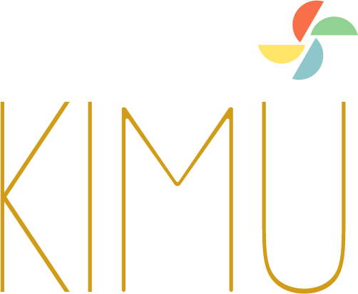

  

# KIMU-CORE — Il cuore modulare di KIMU
> **KIMU - Keep It Minimal UI Framework**

**`KIMU-CORE`** è il runtime leggero e modulare del framework [KIMU](https://github.com/unicoverso/kimu): un framework front-end ultra-minimale, interamente basato su **Web Components**, pensato per interfacce **poetiche**, **estensibili** e **viventi**.

--- 

# 🌐 Traduzioni disponibili

- 🇬🇧 English – [README.md](./README.md)  
- 🇮🇹 Italiano – [README.it.md](./README.it.md)

--- 

Questo pacchetto rappresenta il **motore runtime** del sistema, progettato per essere **piccolo, elegante e autosufficiente**.

> "Ogni estensione è un pensiero. Ogni interfaccia è un gesto."

👉 Questo repository è il **cuore del framework KIMU**.  
Per scoprire la filosofia, docementazioni, esempi, gli altre estensioni,  moduli, demo e il playground, visita il progetto principale:  

> 🔗 **KIMU framework** : **[https://github.com/unicoverso/kimu](https://github.com/unicoverso/kimu)**

> 🔗 **KIMU-core** : **[https://github.com/unicoverso/kimu-core](https://github.com/unicoverso/kimu-core)**

> 🔗 **KIMU docs** : **[https://unicoverso.com/kimu/docs](https://unicoverso.com/kimu/docs)**

> 🔗 **KIMU-docs repository** : **[https://github.com/unicoverso/kimu-docs](https://github.com/unicoverso/kimu-docs)**

> 🔗 **KIMU webpage** : **[https://unicoverso.com/kimu](https://unicoverso.com/kimu)**

Creato da [UnicòVerso](https://unicoverso.com) (Marco Di Pasquale, alias *Hocram*), per realizzare interfacce web leggere, eleganti e reattive.

---

# 🔧 Cos’è `KIMU-CORE`?

`KIMU-CORE` è il **nucleo tecnico** che avvia, carica e orchestra le estensioni del framework [KIMU](https://github.com/UnicoVerso/kimu).

> "Minimale non significa limitazione. Significa intenzionale."

Contiene tutto ciò che serve per:

- 🧠 Registrare e gestire estensioni modulari  
- 🧩 Caricare dinamicamente componenti HTML, JS e CSS  
- 🖇️ Collegare elementi tramite eventi, contesto e stili condivisi  
- 💾 Gestire uno stato locale condiviso e cache in memoria  
- 🧱 Supportare la creazione di **interfacce dichiarative** usando solo Web Components  

Nessun bundler. Nessun Virtual DOM. Nessuna dipendenza. Solo **JavaScript puro** moderno, progettato con intenzione.

> È la base perfetta per ecosistemi modulari, interfacce creative, app a basso impatto o esperienze digitali poetiche.

---

# 🌱 Cos’è KIMU?

**KIMU** è un framework front-end leggero, modulare e flessibile, progettato per creare interfacce utente eleganti ed efficienti con il minimo sforzo e ingombro.

Basato sugli **standard del web**, privo di dipendenze esterne,  
`KIMU` promuove un design **dichiarativo** e **modulare**.

> _“Ogni estensione è un pensiero. Ogni interfaccia è un gesto.”_

---

## 🚀 Come iniziare

👉 Il pacchetto `KIMU-CORE` sarà presto pubblicato su npm.  
Nel frattempo, puoi clonare questo repository o includere i file JS direttamente nel tuo progetto.

Documentazione ed esempi saranno presto disponibili su: 

> 🔗 **KIMU get started** : [Get Started](./docs/index.md)

> 🔗 **KIMU docs online** : [https://unicoverso.com/kimu/docs](https://unicoverso.com/kimu/docs)

---

## 📦 Licenza

Il codice sorgente di `KIMU`, incluso il framework `kimu-core`, 
è rilasciato sotto [Mozilla Public License 2.0 (MPL-2.0)](./LICENSE).  
  
Sei libero di usare, modificare e ridistribuire il codice, nel rispetto di questa licenza, a condizione che le modifiche ai file coperti dalla MPL restino pubbliche con la stessa licenza.

Per maggiori dettagli su attribuzione, contributi e utilizzo dei nomi, consulta il file [NOTICE](./NOTICE).

Consulta il file [`LICENSE`](./LICENSE) per tutti i dettagli.

---

## 🏷️ Nomi e attribuzioni

"KIMU", "KIMU-CORE" e "UnicòVerso" sono nomi creativi associati all'autore originale.  
Consulta il file [`NOTICE`](./NOTICE) per un uso corretto in progetti derivati.

---

## 🤝 Contribuire

Accogliamo con piacere idee, suggerimenti e contributi di ogni tipo.  
Bug fix, nuove estensioni, o anche solo proposte sensate aiutano `KIMU` a crescere.

Contribuendo, accetti i termini descritti in [`NOTICE`](./NOTICE) e [`CONTRIBUTING.md`](./CONTRIBUTING.md).

Le tue contribuzioni saranno sempre riconosciute e rispettate.

---

## 💌 Contribuisci con un pensiero

`KIMU` framework è un progetto nato dalla passione, cresciuto con la cura e portato avanti con il desiderio di costruire qualcosa di leggero, umano e utile.

Se hai scaricato, esplorato o solo sfiorato questa interfaccia, lascia un segno.  
Un pensiero, un'idea, un incoraggiamento, anche solo un saluto.

Ogni messaggio è un raggio di luce.  
Ogni parola può diventare un'estensione.  
Ogni gesto può ispirare a continuare.

📬 Scrivimi anche solo per dire *"Ti vedo, continua."*  

---

## 🧑‍💻 Autore e contatti

Creato e mantenuto da:  
**Marco Di Pasquale** *(alias Hocram)*  
per conto del collettivo creativo **[UnicòVerso](https://unicoverso.com)**

- 🌍 Sito: [https://unicoverso.com/kimu](https://unicoverso.com/kimu)  
- 🐙 GitHub: [https://github.com/unicoverso/kimu-core](https://github.com/unicoverso/kimu-core)  
- 🚀 Framework Reference: [https://github.com/unicoverso/kimu](https://github.com/unicoverso/kimu) 
- 📩 Email: [info@unicoverso.com](mailto:info@unicoverso.com)

---

## 💖 Support / Donate

🇮🇹 **Vuoi sostenere KIMU-Core?**
Scopri tutte le modalità di supporto e donazione nel file [FUNDING.md](./FUNDING.md).

Puoi contribuire tramite:
- [GitHub Sponsors](https://github.com/sponsors/hocram)
- [OpenCollective](https://opencollective.com/unicoverso)
- [Patreon](https://www.patreon.com/UnicoVerso)
- [Ko-fi](https://ko-fi.com/marcodipasquale)
- [PayPal](https://paypal.me/marcodipasquale)
- [BuyMeACoffee](https://www.buymeacoffee.com/hocram)
- [unicoverso.com/dona](https://unicoverso.com/dona)

---

  

> _“KIMU non è solo un framework.  
È un modo per rallentare,  
ascoltare ciò che conta,  
e costruire con intenzione. 🌱”_

  
  Happy coding. Gioca, crea, immagina. Benvenuto su `KIMU`.

